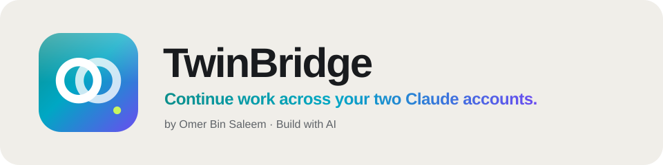

# TwinBridge



**Continue work across your two Claude accounts.**

Many people use two Claude accounts, one for work and one of their own. Each account knows only its own chats, so moving a task from one to the other means explaining it again: what was asked, what is done, what was decided, what comes next.

TwinBridge fixes that with handoffs. When you finish a piece of work, ask Claude to save a handoff. In your other account, open `/bridge` and press **Continue here**, and Claude starts from the same point. Handoffs are stored on a server you run yourself.

By Omer Bin Saleem. MIT licensed.

## Use cases

**Office to home, same task.** You plan a database migration in your work account in the afternoon. In the evening, in your personal account, you press **Continue here**. Claude loads the handoff (the goal, the steps already done, the reason you picked one approach over another, and the next three steps) and carries on.

**Find an old decision.** Weeks later you remember a decision but not where it was made. Search your handoffs from either account and get the title, the summary, the account and the date.

**One project, two contexts.** A side project you sometimes discuss at work, or a tool you prototype at home and use at the office. Both accounts read the same handoffs, so neither starts from zero.

**See every handoff in one list.** The panel shows the latest handoff with the account it came from, and every earlier one below it.

## What TwinBridge does and does not do

- It saves a handoff **only when you ask**, or when Claude asks "Save a handoff for your other account?" after a large piece of work and you say yes.
- A handoff holds what Claude writes in it: a title, a summary, next steps, and optional context such as file paths. Nothing else from the conversation is sent.
- It does **not** read your chat history, Claude's memory or session transcripts, and it does not log your prompts or Claude's replies.
- It does not share a login, merge accounts or switch between them. You choose which account to use.
- If one of your accounts belongs to an employer, their rules still apply to what you move out of it. Check them before you save a handoff with work material.

## What it runs and sends

| Part | What it does | Where data goes |
|---|---|---|
| MCP server `twinbridge` (`.mcp.json`) | Four tools: `save_handoff`, `get_handoff`, `list_handoffs`, `search_handoffs` | Only your handoff server: `<connector_url>/mcp/<account_token>/handoffs` |
| `/bridge` panel (`hooks/register.tsx`) | Shows the latest handoffs and runs your searches | Only your handoff server, with your account token: `GET <connector_url>/api/whoami` and `GET <connector_url>/api/history?only=handoffs` (plus `&q=<your search>`) |
| Skill `twinbridge` | Tells Claude when to save and load handoffs and what to put in them | Nothing |

**Hosts it contacts.** Only the handoff server URL you enter in the plugin's settings. There is no other network access: no analytics, no telemetry, no update checks.

**Programs it runs.** None. The panel starts no processes and reads no files on your computer.

**Prompts it submits.** The panel has two buttons that type a fixed prompt into the conversation for you, and nothing from the conversation is added to them:

- **Continue here**: "Continue my latest TwinBridge handoff: load it with twinbridge get_handoff, then carry on with its next steps."
- **Save handoff**: "Save a TwinBridge handoff now with twinbridge save_handoff: what was asked, what is done, key decisions, and concrete next steps, written for someone with no access to this chat."

The **Save handoff** prompt asks Claude to call `save_handoff`, which sends the handoff Claude writes to your server. That is the only way conversation content leaves the conversation, and only when you press it or ask for a handoff.

**Events it hooks.** `session.start` registers the `/bridge` command. `command.run` for `/bridge` opens the panel. `ui.render` draws the panel. None of them see or change your prompts, Claude's replies or tool calls.

There are no hooks on prompts, replies or tool calls. See [PRIVACY.md](PRIVACY.md) for the full privacy policy.

## Setup

### 1. Run a handoff server

TwinBridge works with the open source ClaudeTwin connector, a small Node.js server you host yourself. Its setup steps are in the [ClaudeTwin README](https://github.com/deadlydiamond/claudetwin#install): create two random tokens (one per account), then run it on your own machine or deploy its Dockerfile to a host you control, with HTTPS and a persistent volume for its data.

### 2. Install the plugin in each account

Install TwinBridge from the Claude directory, or at the prompt of a Claude Code session:

```
/plugin install twinbridge --marketplace deadlydiamond/twinbridge
```

Set these options:

- **Handoff server URL**: for example `https://handoffs.example.com`, with no trailing slash
- **Account token**: the work token in your work account, the personal token in your personal one

### 3. Use it

- Type `/bridge` to open the panel.
- Say "save a handoff" when you stop, or press **Save handoff**.
- In the other account, say "continue from my other account", or press **Continue here**.

## Privacy

Handoffs live only on the server you run. The plugin sends nothing to the author or to any third party. Full details: [PRIVACY.md](PRIVACY.md).

## Support

Open an issue at [github.com/deadlydiamond/twinbridge/issues](https://github.com/deadlydiamond/twinbridge/issues).

## License

MIT, see [LICENSE](LICENSE). Made by [Omer Bin Saleem](https://github.com/deadlydiamond).
